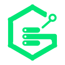
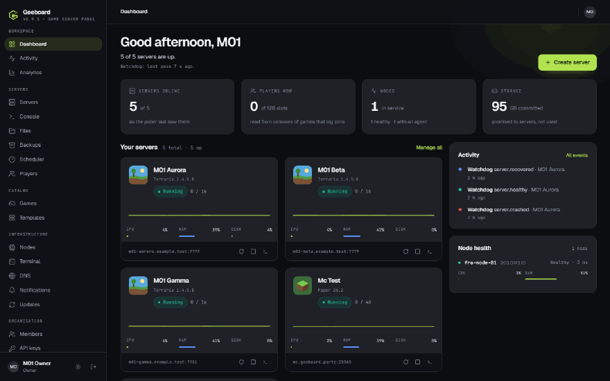
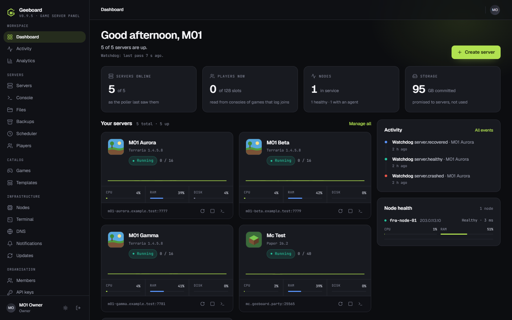
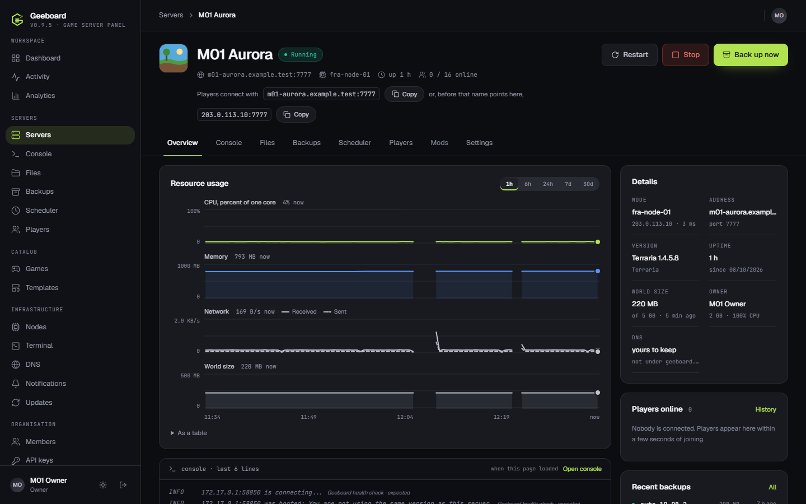
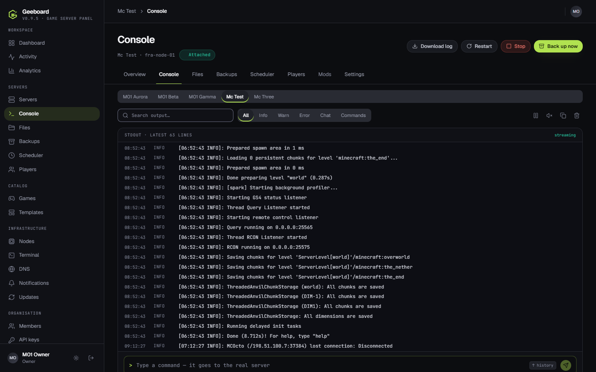
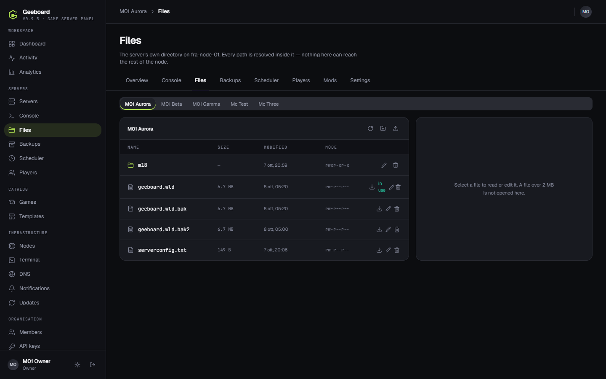
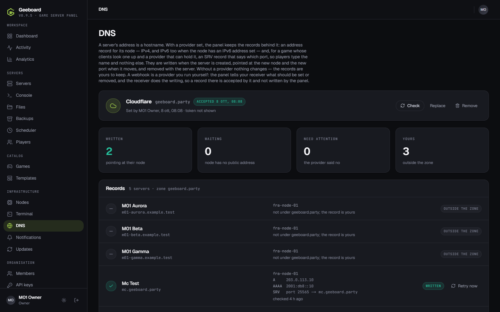
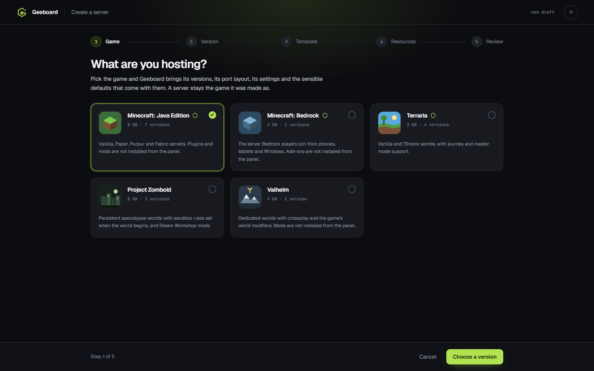

# Geeboard

**An open-source panel that runs game servers on machines you already have.** You bring the machines;
Geeboard puts a small agent on each, and from one panel you create servers, watch their consoles, edit their
files, back them up, move them between machines, give them an address players can type, and hear about it when
something breaks. No cloud account, no per-server fee, no Kubernetes.



<sub>The screenshots here are of a real panel on a small VPS, running Terraria and Minecraft; the machine's address is replaced.</sub>

It is not a Docker dashboard. Docker is how a machine happens to run a server today; the panel, the API and the
database speak in games, versions, nodes and servers, and any one of those could change without the others.

## What it does

- **Six games run for real** — Minecraft: Java, Minecraft: Bedrock, Terraria (vanilla and TShock), Valheim,
  Project Zomboid and Garry's Mod — each with its own versions, settings and a health check that asks the game,
  not the container. Zomboid and Garry's Mod take Steam Workshop mods from the panel, and a game somebody else
  wrote can be added as a reviewed manifest ([community games](docs/community-games.md)).
- **A live console**, a **file manager** that cannot leave a server's folder, and **backups** checked before they
  are trusted, off-site to any S3-compatible bucket if you want one.
- **Addresses people can type**: with a Cloudflare or DuckDNS token, or a webhook of your own, the panel writes the
  `A`, `AAAA` and `SRV` records, so `mc.example.com` reaches a Minecraft server on any port.
- **Nodes** on any Linux machine or a Windows PC, watched, with servers moved between them.
- **Notifications** to Discord or a signed webhook, **an HTTP API** that does what the pages do, and **roles**
  with one permission table behind both.
- **It tells you when a newer Geeboard is out**, and an upgrade dumps the database first and says how to go back.

The whole inventory is [What works today](docs/what-works.md).

## Install it

On a Linux machine with Docker and git (a new Debian or Ubuntu has neither:
`sudo apt-get install -y git curl`, then `curl -fsSL https://get.docker.com | sudo sh`):

```bash
git clone --branch stable https://github.com/DanieleMarino70/Geeboard.git
cd Geeboard
sudo bash deploy/linux/install-panel.sh
```

It asks whether you have a domain name and who the first owner is, and does the rest: the secrets, https either way,
the containers, the database and the first account. Its last question offers this machine as a node; approve it
under **Nodes**, and **Servers → Create a server** is a game running. Run the installer again to upgrade.
[Install Geeboard](docs/production.md) is the whole path, another machine as a node included.

## A look

| | |
| --- | --- |
|  **Dashboard** — servers, nodes, activity |  **A server** — usage, address, details, backups |
|  **Console** — live, searchable, with what the panel's own health checks print marked as expected |  **Files** — in the server's folder, and nowhere else |
|  **Addresses** — the records the panel keeps for each server |  **A new server** — game, version, template, resources, review |

## What has been run, and what has not

Every game offered was run from its own image on a real node before it was offered. Installing, upgrading, going
back and bringing a lost panel back from a dump were run on real machines — a clean Debian VPS with a real certificate
and a real DNS zone, Ubuntu 22.04 and 24.04, a Windows PC, and CI — and [On real machines](docs/release-matrix.md) says
what happened in each. **What is not proved is written down too**, in [What does not work yet](docs/limitations.md),
and [the field checks](docs/field-checks.md) say how to prove the rest. The images carry a bill of materials and are
signed ([Verifying an image](docs/security.md#verifying-an-image)).

## Or try it on a laptop

A checkout runs on a laptop with Docker and Node.js, on a sample workspace whose nodes and servers are simulated
and say so: [the commands](docs/index.md#or-try-it-on-a-laptop). It signs in with the development seed's account,
whose password is written in this repository — which is exactly why the seed refuses to run in production.

## Documentation

**<https://danielemarino70.github.io/Geeboard/>** — for whoever installs it, whoever runs game servers on it, and
whoever builds on it. The same pages are in [docs/](docs/) and read on GitHub as they are.
[CHANGELOG.md](CHANGELOG.md) is what changed between releases, [docs/upgrading.md](docs/upgrading.md) how to move
from one to the next, [docs/roadmap.md](docs/roadmap.md) what 1.0 promises and what may come after it, and
[SECURITY.md](.github/SECURITY.md) how to report a problem.

## Licence

Geeboard is licensed under the GNU Affero General Public License, version 3
only — `AGPL-3.0-only`. The full text is in [LICENSE](LICENSE).

The name **Geeboard** and the mark in `brand/` are not part of that grant —
see [brand/LICENSE.txt](brand/LICENSE.txt). The software is yours to fork; the
badge on it is not, so a fork does not ship as Geeboard.

In short, and not in place of the licence: you may use, study, change and share
it. If you share a changed version, or run one that other people use over a
network — a hosted panel is exactly that — you have to offer them its source
under the same licence (section 13). "Only" means a later version of the
licence does not apply unless the project chooses it.

The games are not part of Geeboard. A node pulls each game's server from its
own image, under that image's and that game's terms — Minecraft's image, for
one, is started with `EULA=TRUE`, which accepts Mojang's EULA on the operator's
behalf.

Nor are the games' posters. They belong to their publishers, and none is in
this repository or in the panel's image: each panel fetches the ones it shows
from Steam's CDN and the Microsoft Store, keeps them in its own database for its
own pages, and draws a cover instead when it has none. `GEEBOARD_COVERS=off`
turns the fetching off ([games.md](docs/games.md#covers)).
